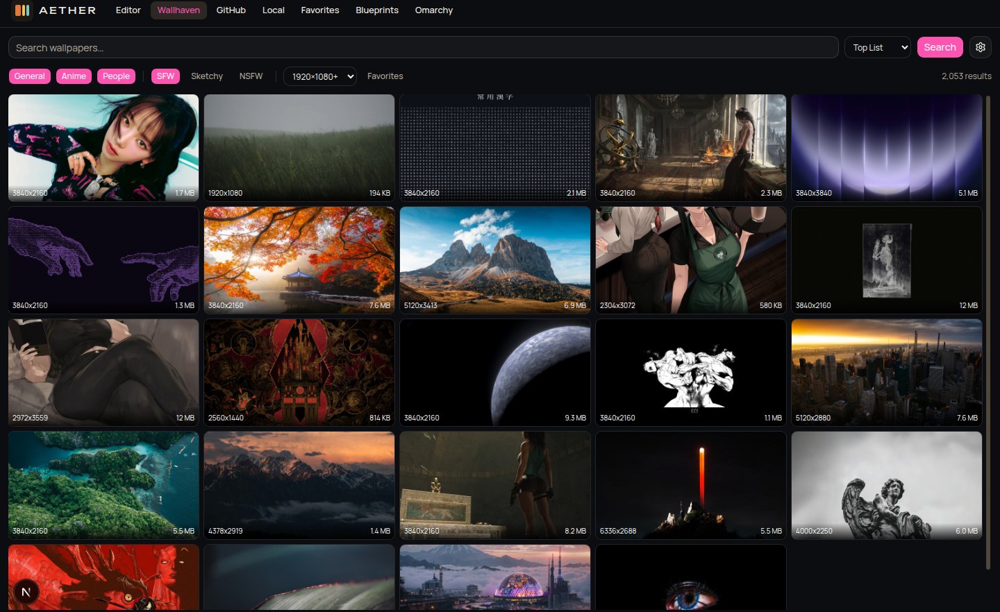
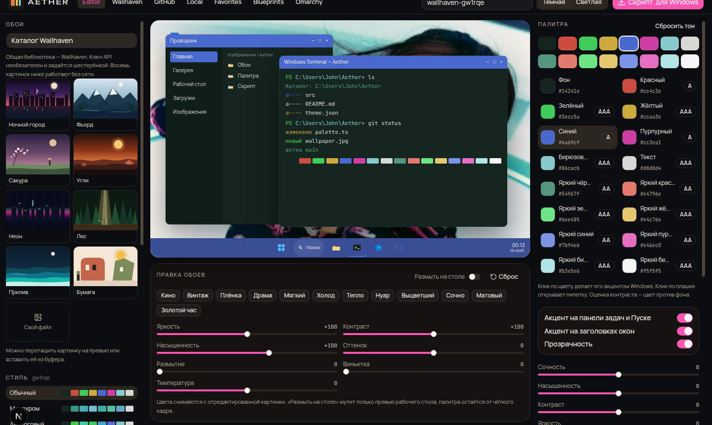

# Aether для Windows

Обои с [Wallhaven](https://wallhaven.cc) и тема Windows, собранная из их цветов. Это Windows-версия [Aether](https://github.com/omacom/aether): там Linux и Omarchy, здесь рабочий стол, акцент, Windows Terminal и VS Code.



## Скачать

Готовое приложение: [aether.exe](https://github.com/relocpe/aether/releases/latest/download/aether.exe).

Оно открывается на Wallhaven. В поиске есть категории General, Anime и People, чистота SFW / Sketchy / NSFW, сортировка и минимальное разрешение. Клик по карточке скачивает обои, ставит их на рабочий стол и записывает акцент в текущую учётную запись. Права администратора не нужны.

Ключ API необязателен. Без него хватает обычного поиска, около 45 запросов в минуту. NSFW на Wallhaven открывается с ключом из настроек аккаунта. Ключ остаётся только на этом компьютере.

## Студия

Студия в браузере снимает с картинки палитру из 16 цветов и показывает, как она ляжет на Windows 11.

```bash
npm install
npm run dev
```

Сервер слушает порт 4177.



Клик по цвету назначает акцент. Светлая и тёмная тема меняют фон и текст местами. **Скрипт для Windows** скачивает `aether-theme.ps1`: кладёт обои в `Изображения\Aether`, ставит их на стол и переключает светлый или тёмный режим.

```powershell
powershell -ExecutionPolicy Bypass -File .\aether-theme.ps1
```

Рядом можно сохранить схему Windows Terminal, фрагмент `settings.json` для VS Code и файл `.theme`. Чертежи хранятся в браузере.

## Сборка

```bash
npm run dist:win
cargo build --release --manifest-path aether-win/Cargo.toml
```

`npm run dist:win` собирает студию в переносимый exe. Команда Cargo собирает `aether.exe`. С Linux ту же Windows-сборку даёт `cargo build --release --target x86_64-pc-windows-gnu`. Тег `v*` запускает обе сборки в GitHub Actions.
